# Steiner Minimal Trees vs Minimum Spanning Trees

*Math 453 (Graph Theory) final project — Giri Vignesh*

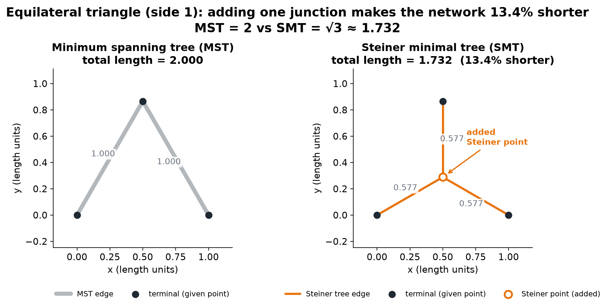

Suppose you must connect a set of towns with roads (or pins on a chip with wires) using as little
total length as possible. If roads may only run directly between towns, the best you can do is a
**minimum spanning tree (MST)**. If you are also allowed to add new junctions anywhere you like,
you can often do better: the shortest such network is a **Steiner minimal tree (SMT)**, and the
added junctions are called **Steiner points**. For three towns at the corners of an equilateral
triangle, one junction in the middle cuts the total length by about 13%. This repo computes both
trees, reproduces every example from my presentation, and measures how much Steiner points save
on random point sets.

> **Note on the solver.** Exact Euclidean SMTs are NP-hard to compute. The default solver here
> (`steiner/smt_heuristic.py`) is a **heuristic**: it always returns a valid Steiner tree, so its
> length is an **upper bound** on the true SMT length, and every ρ it reports is an upper bound on
> the true ratio. It is checked against exact solvers for n = 3 and n = 4. For exact results on
> larger inputs, install GeoSteiner (see [How to run](#how-to-run)); the scripts use it
> automatically when it is on your `PATH`, and every results row records which method produced it.

## The question

For a set of n points in the plane, how much shorter can a Steiner minimal tree be than the
minimum spanning tree? We measure this with the **Steiner ratio**

  ρ = L(SMT) / L(MST),

which is at most 1 (an MST is itself a Steiner tree with no Steiner points). Lower ρ means bigger
savings.

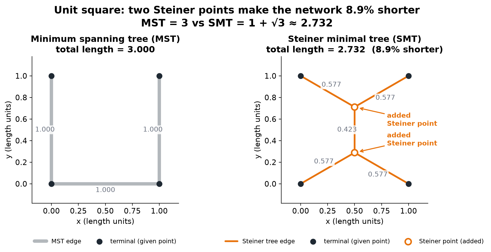
*The unit square: MST = 3, SMT = 1 + √3 (two Steiner points), so ρ = (1 + √3)/3.*

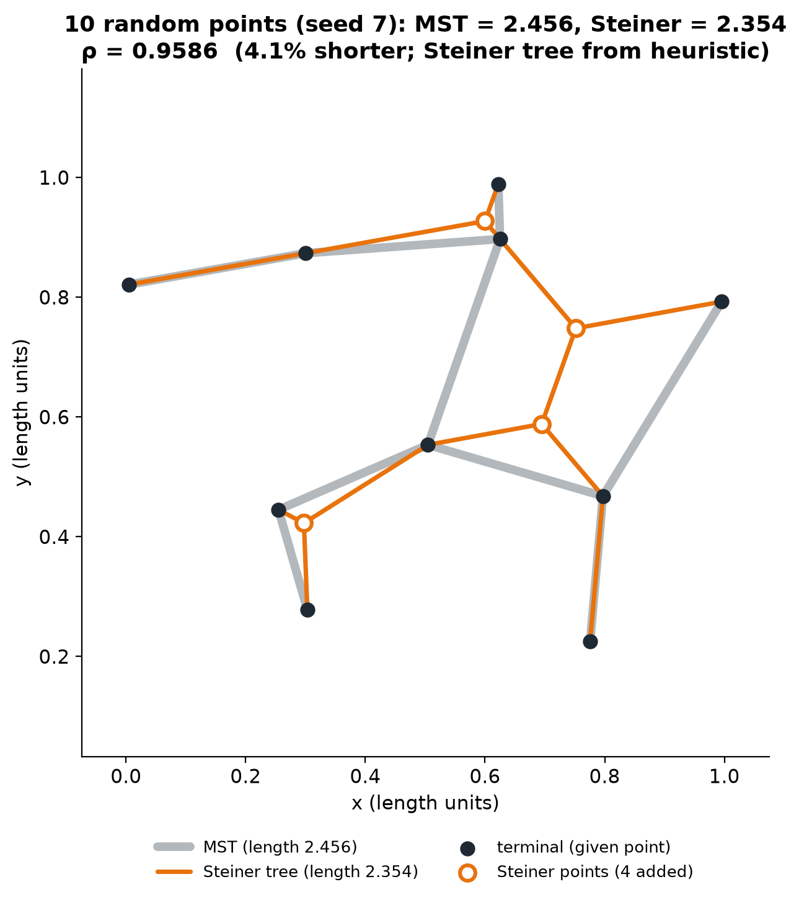
*Ten random points with the MST (gray) and the heuristic Steiner tree (orange) overlaid.*

## Key properties

* **The 120° rule.** Every Steiner point has degree exactly 3, and its three edges meet at 120°.
  More generally, every angle between two edges at any vertex of an SMT is at least 120°.
* **At most n − 2 Steiner points.** A tree whose Steiner points all have degree 3 and whose n
  terminals have degree ≥ 1 can have at most n − 2 Steiner points (count degrees: 2(n + k − 1) ≥ n + 3k).
* **Three points: the Fermat point.** For a triangle with all angles below 120°, the single best
  junction is the Fermat (Torricelli) point, which sees every pair of corners at 120°. If one angle
  is 120° or more, the best "junction" is that corner and no Steiner point helps.

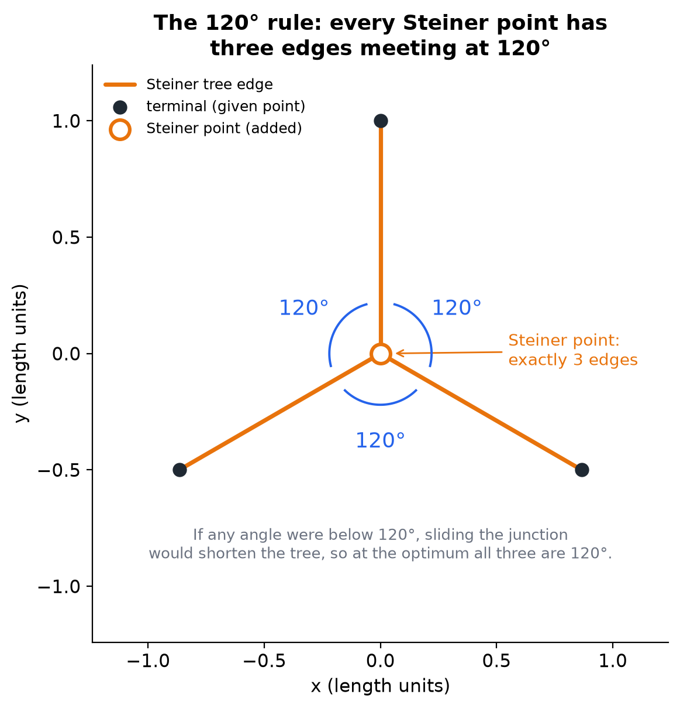
*A Steiner point always has three edges meeting at 120°.*

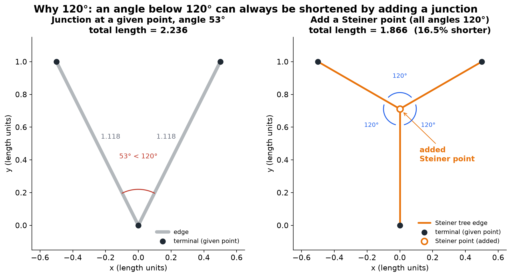
*Any junction with an angle below 120° can be shortened by inserting a Steiner point.*

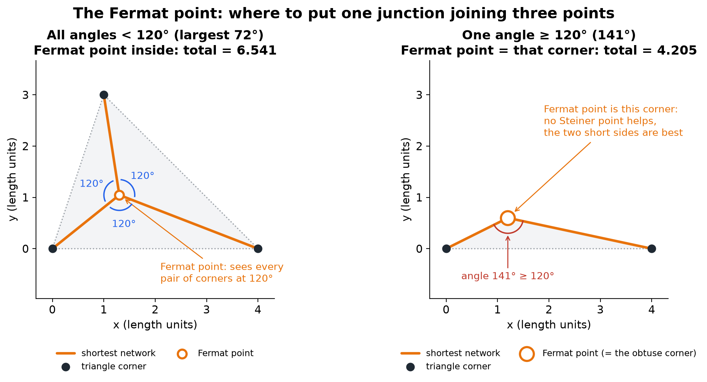
*The Fermat point of a triangle, and the obtuse case where it collapses onto a corner.*

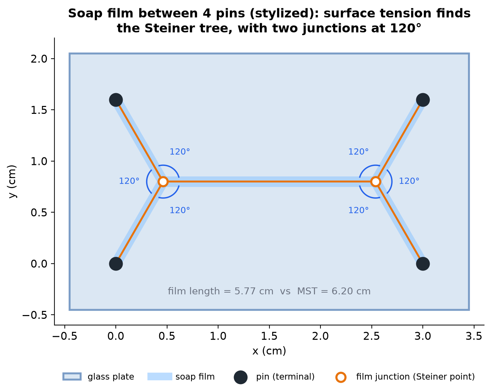
*Soap films minimise length (surface tension), so a film between pins forms a Steiner tree with 120° junctions (stylized).*

## Why it's hard

The Euclidean Steiner tree problem is **NP-hard** (Garey, Graham & Johnson, 1977). One way to see
the difficulty: an SMT is built from *full* Steiner topologies, and the number of full topologies
on n terminals is (2n − 5)!!, which grows faster than exponentially. Once the topology is fixed,
the best positions of the Steiner points are easy to find (it is a convex problem), but there are
far too many topologies to try them all.

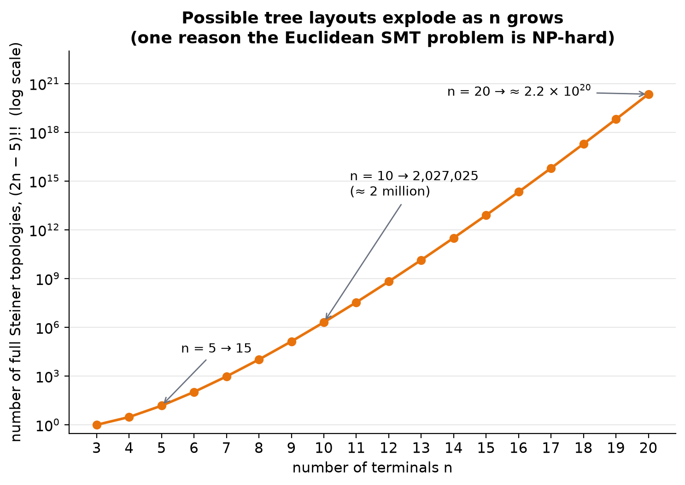
*The number of full Steiner topologies, (2n − 5)!!, on a log scale.*

## Experiment

`scripts/run_experiment.py` draws n points uniformly at random in the unit square (seeded, so
every trial is reproducible), computes the MST with Kruskal's algorithm (union-find written from
scratch) and a Steiner tree, and records ρ. It uses n = 5, 10, 20, 30, 50, 75, 100, with fewer
trials for large n to keep the run short (about a minute on a laptop). Raw rows are in
`results/random_trials.csv`, summaries in `results/summary.json`.

**How the heuristic works** (`steiner/smt_heuristic.py`): start from the MST; repeatedly find a
vertex whose two incident edges meet at less than 120°, and replace those two edges with a new
Steiner point at the Fermat point of the three vertices (taking the insertion with the largest
gain); after each insertion, move every affected Steiner point to the Fermat point of its three
neighbours until nothing moves (Weiszfeld-style smoothing); delete Steiner points that end up with
degree 2 or collapse onto a neighbour. This is repeated from several randomised starting trees and
the shortest result kept.

**Validation** (`pytest`): Kruskal matches SciPy's MST; the equilateral triangle gives ρ = √3/2 and
the unit square ρ = (1 + √3)/3 to 1e-6; every Steiner point has degree 3 with angles within 1° of
120°; the heuristic is never longer than the MST and never uses more than n − 2 Steiner points;
and on 50 random 4-point sets the heuristic matches the exact solver in `steiner/exact_small.py`.

## Results

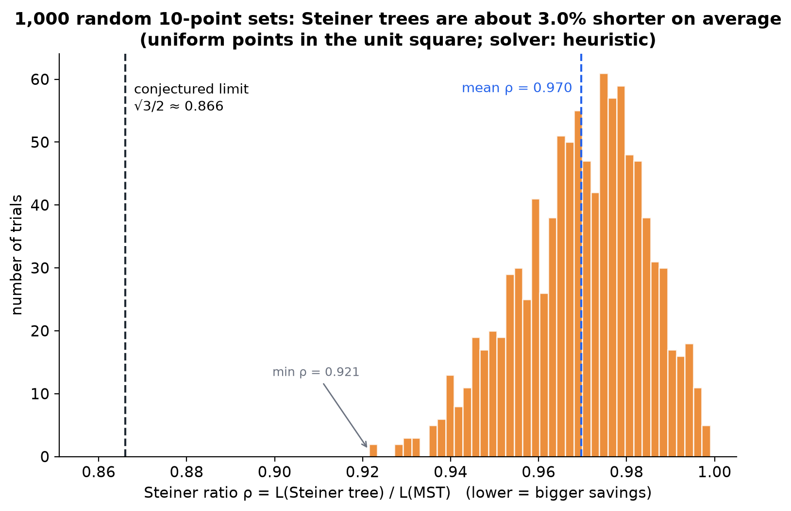
*Distribution of ρ over the random 10-point trials, with the conjectured limit √3/2 and the mean marked.*

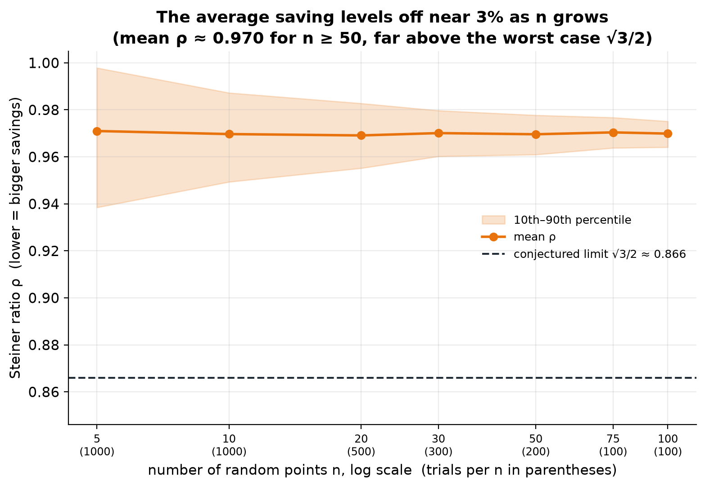
*Mean ρ and its 10th–90th percentile band as the number of random points grows.*

<!-- RESULTS:START -->

*Generated by `scripts/update_readme.py` from `results/summary.json` and `results/conjecture.csv`. Solver: **heuristic** (upper bound on the true SMT, so ρ values are upper bounds).*

**Headline:** over 1,000 random 10-point sets, mean ρ = **0.9697** (median 0.9711, min 0.9214), i.e. Steiner trees are about 3.0% shorter than MSTs on average.

**Large-n plateau:** pooling the 400 trials with n ≥ 50, mean ρ = **0.9699**.

| n | trials | mean ρ | median ρ | min ρ | 10th–90th pct | mean saving | mean # Steiner pts |
|---:|---:|---:|---:|---:|:---:|---:|---:|
| 5 | 1,000 | 0.9710 | 0.9755 | 0.8834 | 0.9385–0.9979 | 2.90% | 1.61 |
| 10 | 1,000 | 0.9697 | 0.9711 | 0.9214 | 0.9494–0.9872 | 3.03% | 3.62 |
| 20 | 500 | 0.9691 | 0.9698 | 0.9355 | 0.9552–0.9828 | 3.09% | 7.74 |
| 30 | 300 | 0.9701 | 0.9710 | 0.9411 | 0.9602–0.9797 | 2.99% | 11.77 |
| 50 | 200 | 0.9696 | 0.9695 | 0.9494 | 0.9610–0.9777 | 3.04% | 19.50 |
| 75 | 100 | 0.9704 | 0.9698 | 0.9532 | 0.9638–0.9767 | 2.96% | 29.67 |
| 100 | 100 | 0.9699 | 0.9700 | 0.9604 | 0.9641–0.9751 | 3.01% | 39.99 |

**Smallest ρ per point-set family** (conjecture: ρ ≥ √3/2 ≈ 0.8660):

| family | n | ρ | reduction |
|---|---:|---:|---:|
| equilateral triangle | 3 | 0.8660 | 13.40% |
| triangular lattice patch | 7 | 0.8660 | 13.40% |
| random search | 4 | 0.8671 | 13.29% |
| square | 4 | 0.9107 | 8.93% |
| square grid | 16 | 0.9240 | 7.60% |
| regular hexagon | 6 | 1.0000 | 0.00% |

<!-- RESULTS:END -->

## Gilbert–Pollak conjecture

Gilbert and Pollak (1968) conjectured that **ρ ≥ √3/2 ≈ 0.866 for every point set in the plane**,
with equality for the equilateral triangle; in other words, Steiner points can never save more
than about 13.4%. Du and Hwang announced a proof in 1990, but a gap was later found in it, so the
conjecture is generally regarded as open. `scripts/test_conjecture.py` searches for small ratios
among structured families (regular polygons, triangular-lattice patches, square grids) and with
random search plus hill-climbing. Since the heuristic can only over-estimate ρ, a value below
√3/2 would indicate a bug rather than a counterexample; none was found. Point sets built from
equilateral triangles (the triangle itself, and the hexagon with its centre) reach √3/2 exactly.

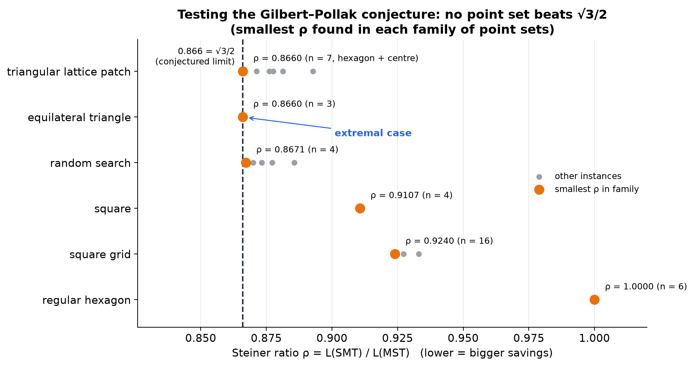
*Smallest ρ found in each family of point sets; nothing goes below the dashed line at √3/2.*

## Rectilinear version

If distance is measured along a grid (L1 or "Manhattan" distance, as for wires on a chip), the
problem becomes the **rectilinear Steiner tree problem**. Hanan (1966) showed that an optimal tree
only needs Steiner points on the *Hanan grid* (crossings of horizontal and vertical lines through
the terminals); `steiner/rectilinear.py` uses that to find exact rectilinear SMTs for n ≤ 6 by
brute force. The rectilinear Steiner ratio is **2/3** (Hwang, 1976), achieved by the "plus" shape
below.

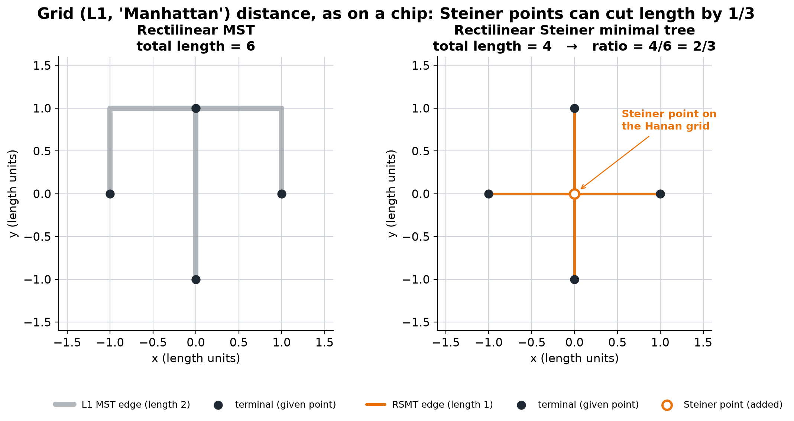
*Plus-shaped terminals: L1 MST = 6, rectilinear SMT = 4, ratio 2/3.*

## Real-world applications

* **VLSI chip routing:** connecting the pins of a net with wires on a grid is a rectilinear
  Steiner tree problem; shorter wires mean less delay, power and area.
* **Telecom and utility networks:** laying fibre, pipelines or power lines between sites, where
  junctions can be placed anywhere.
* **Transportation:** road and rail networks, where intersections act as Steiner points.
* (Also: phylogenetic trees in biology, and soap-film / minimal-surface physics.)

## How to run

Requires Python 3.10+.

```bash
python -m venv .venv
```

```bash
source .venv/bin/activate        # Windows: .venv\Scripts\activate
```

```bash
make all                         # install, test, experiment, conjecture search, figures, README table
```

Without `make` (e.g. on Windows), the same pipeline is:

```bash
python run_all.py
```

Individual steps: `make install`, `make test`, `make experiment`, `make conjecture`, `make figures`,
`make readme`. `python scripts/run_experiment.py --quick` runs a small smoke test.

**Exact results with GeoSteiner (optional).** Download and build GeoSteiner from
<http://www.geosteiner.com/> (it is C source, not on PyPI), then put the `efst` and `bb` programs
on your `PATH`. `steiner/geosteiner.py` detects them, pipes the points through `efst | bb`, and the
results files record `method = geosteiner`. If they are missing, the scripts fall back to the
heuristic and say so. (The output parser was written from the GeoSteiner documentation and has not
been tested against a live install.)

## Repo structure

```
steiner/
  geometry.py       distances, angles, Fermat point (closed form) and Weiszfeld iteration
  mst.py            Kruskal's algorithm with a hand-written union-find (Euclidean and L1)
  smt_heuristic.py  Euclidean Steiner tree heuristic (upper bound on the SMT)
  exact_small.py    exact SMT for n = 3 and n = 4, used to validate the heuristic
  rectilinear.py    rectilinear MST and exact rectilinear SMT (Hanan grid, n <= 6)
  topology.py       number of full Steiner topologies, (2n - 5)!!
  pointsets.py      random, triangle, square, regular polygons, lattice patches, grids
  geosteiner.py     optional exact solver wrapper (falls back to the heuristic)
  plotting.py       shared figure style
scripts/
  run_experiment.py   random trials -> results/random_trials.csv, results/summary.json
  test_conjecture.py  smallest-ratio search -> results/conjecture.csv
  make_figures.py     every figure -> figures/*.png
  update_readme.py    regenerates the Results tables in this README
tests/                pytest suite
figures/, results/    generated outputs (committed)
```

## References

* E. N. Gilbert and H. O. Pollak, "Steiner minimal trees," *SIAM Journal on Applied Mathematics*
  16(1), 1–29, 1968.
* M. R. Garey, R. L. Graham and D. S. Johnson, "The complexity of computing Steiner minimal
  trees," *SIAM Journal on Applied Mathematics* 32(4), 835–859, 1977.
* D.-Z. Du and F. K. Hwang, "An approach for proving lower bounds: solution of Gilbert–Pollak's
  conjecture on Steiner ratio," *Proc. 31st IEEE FOCS*, 76–85, 1990 (a gap in the proof was later
  identified).
* F. K. Hwang, "On Steiner minimal trees with rectilinear distance," *SIAM Journal on Applied
  Mathematics* 30(1), 104–114, 1976.
* M. Hanan, "On Steiner's problem with rectilinear distance," *SIAM Journal on Applied
  Mathematics* 14(2), 255–265, 1966.
* GeoSteiner: software for computing Steiner trees, D. M. Warme, P. Winter and M. Zachariasen,
  <http://www.geosteiner.com/>.

## License

MIT — see [LICENSE](LICENSE).
